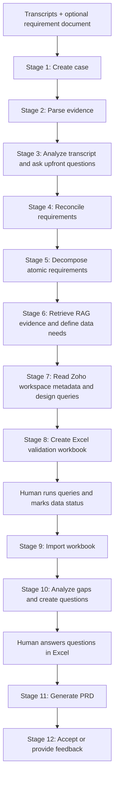

# Zoho Requirements-to-PRD Project Workflow

This project converts meeting evidence into validated analytics requirements and a client-ready PRD.

The pipeline uses:

- Meeting transcripts and an optional requirement document as business input.
- A RAG MCP service for Zoho Finance definitions, formulas, and report guidance.
- An authenticated Zoho Analytics MCP service for workspace and metadata discovery.
- Claude or the local mock client for structured reasoning.
- A human-owned Excel validation step before the PRD is generated.

The system reads metadata and generates validation queries. It does not query or evaluate original customer data automatically.

For a no-interception run, pass `--unattended`. The pipeline fills stage-3
questions, populates the validation workbook with explicit metadata-only
assumptions, answers generated gap questions, and automatically accepts the
generated draft. This mode produces the questions analyser, validation
workbook, and final PRD; it does not represent customer verification.

## Analysis Contract

The pipeline uses `pipeline/template_contract.py` as the shared contract between
transcript analysis, reconciliation, decomposition, validation, and PRD generation.
The contract requires:

- Evidence classification before scope decisions.
- Explicit source-of-truth, grain, time logic, formulas, exclusions, and data-quality gates.
- Traceability from each requirement to evidence, source systems, report surfaces,
  acceptance criteria, and a validation method.
- Separate treatment of confirmed facts, assumptions, conflicts, commercial terms,
  delivery commitments, and unresolved questions.
- A fixed PRD structure with report-level definitions for Property-Level Custom P&L,
  Portfolio / All-Properties Comparison, and Current Assets Summary.

## End-to-End Flow



## Input

The CLI entry point is `main.py`.

Required for a new run:

- At least one `.txt` or `.md` transcript.
- A Zoho Analytics workspace name for stages 6 and 7.

Optional:

- A `.txt` or `.md` requirement document.
- A custom RAG MCP URL.
- A custom Zoho Analytics MCP URL.
- `--mock` to run without the Claude API.

Example:

```powershell
py main.py run --transcripts transcript.txt --requirement requirement.txt --workspace "Customer Analytics"
```

## Stage Handoffs

Every structured stage output is validated with Pydantic models from `pipeline/models.py` and saved by `pipeline/case_store.py`. This is how one process carries its result into the next process.

| Stage | Owning file | Receives | Produces | Persisted output |
|---|---|---|---|---|
| 1. Case creation | `pipeline/stage1_intake.py` | Input file paths | Case folder, manifest, copied evidence | `manifest.json`, `evidence/` |
| 2. Document parsing | `pipeline/stage2_parsing.py` | Manifest and evidence files | `CaseContext` | `state/02_document_parsing.json` |
| 3. Transcript analysis | `pipeline/stage3_transcript_analysis.py` | `CaseContext` | Confirmed signals, assumptions, ambiguity risks, and answerable clarification questions | `state/03_transcript_analysis.json`, `transcript_analysis_report.md` |
| 4. Requirement reconciliation | `pipeline/stage3_reconciliation.py` | `CaseContext` and transcript analysis | Unified baseline and conflicts | `state/04_requirement_reconciliation.json` |
| 5. Requirement decomposition | `pipeline/stage4_decomposition.py` | Requirement baseline | Atomic `REQ-###` requirements | `state/05_requirement_decomposition.json` |
| 6. Data need specification | `pipeline/stage5_data_needs.py` | Atomic requirements and RAG results | Conceptual entities, fields, formulas, joins, and filters | `state/06_data_need_specification.json` |
| 6. RAG retrieval audit | `pipeline/stage5_data_needs.py`, `pipeline/rag_mcp_client.py` | Atomic requirement text | Retrieved rulebook chunks and scores | `state/65_rulebook_retrieval.json` |
| 7. Metadata and query design | `adapters/live_analytics_mcp_adapter.py`, `pipeline/stage6_sql_discovery.py` | Data needs and live workspace schema | Metadata paths and read-only validation queries | `state/07_metadata_query_design.json` |
| 8. Workbook generation | `pipeline/stage7_validation_workbook.py` | Requirements, data needs, RAG evidence, queries | Human validation workbook | `validation_workbook.xlsx` |
| 9. Human validation import | `pipeline/stage8_human_validation.py` | Edited workbook | Human statuses, notes, and answers | `state/09_human_validation_import.json` |
| 10. Gap analysis | `pipeline/stage9_gap_analysis.py` | Human results, requirements, data needs | Gaps, conflicts, readiness, clarification questions | `state/10_gap_clarification_analysis.json` |
| 11. PRD generation | `pipeline/stage10_scope_generation.py` | Finalized data plus answered workbook questions | PRD markdown and Word document | `state/11_prd_generation.json`, `prd_draft.md`, `client_ready_prd.docx` |
| 12. Acceptance | `pipeline/stage11_acceptance.py` | PRD draft | Acceptance decision and feedback | `feedback.json` |

## What Each Stage Does

### Stage 1: Create a case

`stage1_intake.py` creates a unique case ID and copies the supplied input files into the case's `evidence/` directory. The manifest records which files are transcripts and which file is the optional requirement document.

### Stage 2: Parse documents

`stage2_parsing.py` reads the copied `.txt` and `.md` files and creates one `CaseContext` object. This is the normalized evidence passed to the reasoning stages.

PDF and DOCX extraction are not implemented in the current local prototype.

### Stage 3: Analyze the transcript before implementation thinking

`stage3_transcript_analysis.py` reviews the complete transcript evidence as a business-value analyst for Zoho Analytics. It separates confirmed stakeholder signals from analyst suggestions, surfaces assumptions and ambiguity risks, and produces specific questions with business impact and priority. The result is saved as both structured JSON and `transcript_analysis_report.md`.

This stage does not expose private chain-of-thought or make decisions on behalf of stakeholders. It creates a shared decision brief so humans can resolve source-of-truth, metric, time, scope, data-quality, and acceptance questions before reconciliation and implementation planning.

### Stage 4: Reconcile requirements

`stage3_reconciliation.py` sends all transcripts and the optional requirement document to Claude. It produces one consistent requirement baseline and explicitly records conflicts instead of silently choosing between contradictory statements.

### Stage 5: Decompose requirements

`stage4_decomposition.py` converts the baseline into atomic, testable requirements with sequential IDs such as `REQ-001`. Each requirement is classified as a metric, dimension, filter, time logic, or business rule.

### Stage 6: Define data needs using RAG

`stage5_data_needs.py` asks `rag_mcp_client.py` to search the external RAG MCP service for each atomic requirement. It searches for:

1. The original requirement.
2. Metric definitions, formulas, and variables.
3. Report setup, fields, filters, and limitations.

The RAG service is implemented in the separate knowledge-base project by `rag_mcp_server_sse.py` and `rag_common.py`. It searches embedded Zoho documentation stored in Chroma.

Claude then converts the retrieved evidence into conceptual data needs. At this point the system identifies concepts such as a transaction date, product cost, or aggregation, but it does not claim that a particular customer table or field exists.

### Stage 7: Map to Zoho metadata

`live_analytics_mcp_adapter.py` connects to the Zoho Analytics MCP service and:

1. Finds the workspace by its exact name.
2. Lists its views.
3. Retrieves column metadata for each view.
4. Converts the result into a schema for the next stage.

`stage6_sql_discovery.py` gives the schema and conceptual data needs to Claude. Claude generates metadata paths and read-only candidate queries. The pipeline does not execute those queries against customer data.

### Stage 8: Create the Excel validation workbook

`stage7_validation_workbook.py` creates `validation_workbook.xlsx` with these worksheets:

- `Validation Matrix`: requirements, formulas, evidence, data concepts, metadata paths, queries, and human status.
- `Knowledge Base Evidence`: retrieved RAG chunks and scores.
- `Gaps & Clarifications`: initial unresolved questions.
- `Instructions`: the human validation workflow.

### Stage 9: Import human validation

A human runs the generated queries in the approved Zoho interface and sets every requirement to one of:

- `Available`
- `Missing`
- `Soiled Data`
- `Partially Available`
- `Unclear`

`stage8_human_validation.py` imports these statuses, notes, and client answers. It stops if any requirement has no status.

The human is the authority on whether real customer data exists, is complete, and is usable.

### Stage 10: Analyze gaps

`stage9_gap_analysis.py` reviews the human results and identifies missing data, soiled data, conflicting definitions, readiness, and specific clarification questions. `main.py` appends those questions to the same workbook.

The workflow pauses here so the human or client can answer the questions.

### Stage 11: Generate the PRD

`stage10_scope_generation.py` requires every applicable clarification question in the workbook to have an answer. It generates the PRD from finalized requirements, RAG-grounded data needs, human validation results, gap analysis, and client answers.

The generated document preserves editable placeholders for feasibility, effort, rates, and costs rather than inventing them.

### Stage 12: Accept the PRD

`stage11_acceptance.py` displays the PRD and asks the user to accept it or enter feedback. The decision is saved in `feedback.json`.

## Case Folder Layout

Each run creates a folder under `cases/`:

```text
cases/<case_id>/
    manifest.json
    evidence/
        transcript files
        requirement document
    state/
        structured stage outputs as JSON
    logs/
        Claude prompts and responses
        RAG MCP calls
        Zoho Analytics MCP calls
    validation_workbook.xlsx
    prd_draft.md
    client_ready_prd.docx
    feedback.json
```

The saved state allows a later run to resume from a stage without repeating earlier Claude calls.

## Run Commands

### Offline/mock run through the workbook

```powershell
py main.py run --mock --to-stage 7 `
  --transcripts sample_case\transcript_1_kickoff.txt `
  --requirement sample_case\requirement.txt `
  --workspace "Customer Analytics"
```

The recommended first pass is to stop after Stage 3, review the upfront questions, and then resume:

```powershell
py main.py run --mock --to-stage 3 --transcripts transcript.txt
py main.py run --mock --from-stage 4 --case-id <case_id>
```

Complete `validation_workbook.xlsx`, then import the answers and generate gap questions:

```powershell
py main.py run --mock --from-stage 9 --to-stage 10 --case-id <case_id>
```

Answer the added questions in the workbook, then generate the PRD:

```powershell
py main.py run --mock --from-stage 11 --case-id <case_id>
```

### Real Claude run

```powershell
py main.py run --to-stage 8 `
  --transcripts transcript.txt `
  --requirement requirement.txt `
  --workspace "Customer Analytics"
```

The real run requires `ANTHROPIC_API_KEY` in `.env`, a running RAG MCP service, and a reachable authenticated Zoho Analytics MCP service.

### Live REST metadata export

For a direct read-only API check, set the OAuth values and the server URI for the
Zoho data center. For the India account shown in the discovery session:

```powershell
$env:ACCOUNTS_SERVER_URL = "https://accounts.zoho.in"
$env:ANALYTICS_SERVER_URL = "https://analyticsapi.zoho.in"
py main.py export-metadata --org-id "<organization-id>" --output cases\spandan_live_metadata.json
```

The exporter lists workspaces and views, then calls Zoho's documented
`/restapi/v2/workspaces/{workspace-id}/views/{view-id}/metadata` endpoint for
each view. It stores metadata only; it does not query business rows. Use an
existing `ANALYTICS_ACCESS_TOKEN` for a short-lived check, or configure the
client ID, client secret, and refresh token for OAuth refresh-token access.

The deterministic Spandan fixture is `sample_case\spandan_mock_data.csv` and is
used alongside `sample_case\workspace_metadata.json` by
`_run_spandan_mock_prd.py`. It contains no customer data.

### Resume an existing case

```powershell
py main.py run --from-stage 7 --case-id <case_id> --workspace "Customer Analytics"
```

When `ANALYTICS_ORG_ID` and either `ANALYTICS_REFRESH_TOKEN` or
`ANALYTICS_ACCESS_TOKEN` are configured in `.env`, stage 7 automatically uses
the read-only Zoho REST metadata exporter and stores
`zoho_metadata.json` in the case folder. Use `--metadata-source mcp` to retain
the MCP route explicitly, or `--metadata <path>` to use an existing export.

### Check the RAG service

```powershell
py main.py knowledge-status
```

## External Services

The RAG client defaults to `http://localhost:8080/sse` in `pipeline/rag_mcp_client.py`. The RAG server commonly runs at `http://localhost:8100/sse`; set `RAG_MCP_URL` or pass `--rag-url` when these differ.

The Zoho Analytics MCP URL is read from `ANALYTICS_MCP_URL` or supplied with `--analytics-mcp-url`.

The RAG knowledge base project must ingest documents into Chroma before searches return useful results. Its service exposes `search_knowledge_base`, `list_categories`, and `ingest_documents`.

## Design Rules

- Business definitions come from transcript evidence, requirement documents, RAG evidence, or explicit client answers.
- Metadata mapping uses only fields returned by the authenticated Zoho Analytics MCP service.
- Generated SQL is read-only and is intended for human validation.
- The agent does not decide actual customer-data availability from metadata alone.
- The PRD is generated only after human validation and clarification answers.
- Every Claude and MCP interaction is logged under the case for auditability.
